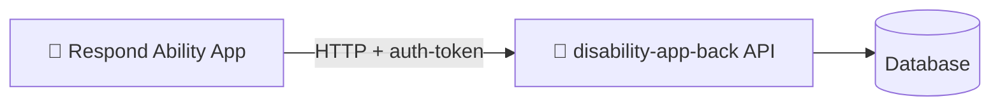

# Respond Ability

**Mobile frontend for disability support teams** — manage participants, track daily forms, generate reports, and coordinate staff from iOS and Android.

[](https://expo.dev)
[](https://reactnative.dev)
[](https://www.typescriptlang.org)

---

## What is this project?

**Respond Ability** is the client-facing mobile app for disability care providers. Staff can log in, browse participants, fill in behaviour and activity forms, view analytics charts, export PDF reports, and manage users — all from a phone or tablet.

This repository is the **frontend**. It talks to **[disability-app-back](https://github.com/freddyarh/disability-app-back)**, which is the REST API backend that handles authentication, data storage, and business logic.



---

## Features

| Area | What you can do |
|------|-----------------|
| **Authentication** | Login, forgot password, verification code, change password |
| **Participants** | List, create, and view client profiles (NDIS details, goals, support network) |
| **Daily forms** | Record activities, functionality, prompts, and behaviours |
| **Reports** | Bar charts, date filters, PDF export and sharing |
| **Staff** | Create and manage staff members |
| **Accessibility** | High-contrast theme toggle with haptic feedback |

---

## Tech stack

| Layer | Technologies |
|-------|--------------|
| **Framework** | [Expo](https://expo.dev) 51, [React Native](https://reactnative.dev) 0.74, [React](https://react.dev) 18 |
| **Language** | [TypeScript](https://www.typescriptlang.org) |
| **Navigation** | [React Navigation](https://reactnavigation.org) (Drawer + Native Stack) |
| **UI** | [React Native Paper](https://callstack.github.io/react-native-paper/), custom theme system |
| **API client** | [Axios](https://axios-http.com) |
| **Storage** | [AsyncStorage](https://react-native-async-storage.github.io/async-storage/) (auth token) |
| **Charts & PDF** | react-native-svg-charts, expo-print, expo-sharing |
| **Animations** | [Lottie](https://lottiefiles.com), [Reanimated](https://docs.swmansion.com/react-native-reanimated/) |
| **Build & deploy** | [EAS Build](https://docs.expo.dev/build/introduction/) |

---

## Prerequisites

Before you start, make sure you have:

- **Node.js** 18+ (22 recommended for CI)
- **npm** or **yarn**
- **[Expo CLI](https://docs.expo.dev/get-started/installation/)** (`npx expo` works out of the box)
- **Expo Go** on your phone, or Android Studio / Xcode for native builds
- The **[backend](https://github.com/freddyarh/disability-app-back)** running locally or a reachable API URL

---

## Quick start

### 1. Clone and install

```bash
git clone https://github.com/freddyarh/disability-app.git
cd disability-app
npm install
```

### 2. Configure environment variables

Create a `.env` file in the project root (this file is gitignored):

```env
URL_DEV=http://localhost:3000/api
URL_PRO=https://api.respondability.com.au/api
```

| Variable | Description |
|----------|-------------|
| `URL_DEV` | API base URL used during local development |
| `URL_PRO` | Production API URL (used in EAS production builds) |

> **Tip:** Point `URL_DEV` to your local backend. See the [backend repo](https://github.com/freddyarh/disability-app-back) for how to start the API server.

### 3. Start the backend

In a separate terminal, start **disability-app-back** following its README. The app will not work without a running API.

### 4. Run the app

```bash
npm start
```

Expo Dev Tools opens in your terminal. From there you can:

- Press **`a`** → open on Android emulator or device
- Press **`i`** → open on iOS simulator (macOS only)
- Scan the **QR code** → open in Expo Go on your phone

### Platform-specific commands

```bash
npm run android   # Build and run on Android
npm run ios       # Build and run on iOS
npm run web       # Run in the browser
npm test          # Run Jest tests
```

---

## Project structure

```
disability-app/
├── App.tsx                 # App entry — fonts, providers, navigation
├── app.config.ts           # Expo app configuration
├── eas.json                # EAS Build profiles and env vars
├── assets/                 # Images, fonts, Lottie animations
└── src/
    ├── api/                # Axios instance (disabilityApi)
    ├── auth/               # Login, password recovery screens
    ├── components/         # Reusable UI components
    ├── context/            # Auth & theme providers
    ├── hooks/              # Custom React hooks
    ├── interfaces/         # TypeScript types
    ├── navigator/          # Stack & drawer navigation
    ├── screens/            # Main app screens
    └── styles/             # Colors, fonts, global styles
```

---

## Backend connection

All API requests go through `src/api/disabilityApi.tsx`. The client:

1. Reads the base URL from `URL_DEV` (via `react-native-dotenv`)
2. Attaches the `auth-token` header from AsyncStorage on every request

Make sure your backend URL matches the port and path your API exposes (typically `/api`).

**Related repository:** [github.com/freddyarh/disability-app-back](https://github.com/freddyarh/disability-app-back)

---

## Production builds

Production Android builds are triggered automatically on pushes to `main` via GitHub Actions and **EAS Build**.

To build manually:

```bash
npx eas build --profile production --platform android
```

Production environment variables are defined in `eas.json`.

---

## License

Private project — all rights reserved.
